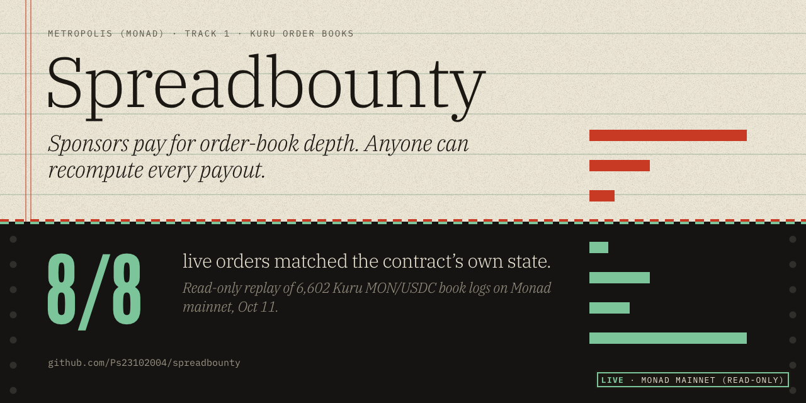

# Spreadbounty

Verifiable maker-depth incentives for Kuru order books on Monad. Built for **Metropolis (Monad)**, Track 1: Onchain Finance & Trading.

- **What it is and why:** [`spreadbounty/PRODUCT.md`](spreadbounty/PRODUCT.md)
- **Submission write-up:** [`spreadbounty/WRITEUP.md`](spreadbounty/WRITEUP.md) · **Judge FAQ:** [`spreadbounty/FAQ.md`](spreadbounty/FAQ.md)
- **Run it:** [`spreadbounty/README.md`](spreadbounty/README.md) (`cd spreadbounty && npm install && npm start`)
- **Day-0 mainnet test** (read-only checks + optional funded live run): [`day0/spreadbounty/`](day0/spreadbounty/) · reports in [`day0/spreadbounty/reports/`](day0/spreadbounty/reports/)

## Status, plainly (Oct 11, 2026)

| | |
|---|---|
| Tests | `npm run test:all` → 94 pass (core, code boundary, AI and bring-your-own-model, maker bot, claim contract on a local EVM, server, browser recompute, judge, shadow run) |
| Mainnet, read-only | Kuru markets verified; MON/USDC: 6,602 book logs replayed, 8/8 live orders match `s_orders`, deterministic roots. AUSD/USDC book was empty |
| Mainnet, write path | **Not run.** No live maker/taker orders, no closed live epoch, distributor not deployed on Monad |
| Data in the app | Labelled synthetic dataset unless `DATA_SOURCE=live` |

Everything was built inside the hackathon window; the commit history starts Oct 9, 2026.
