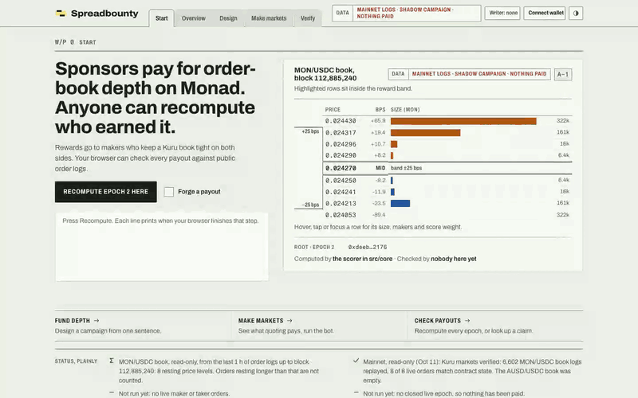
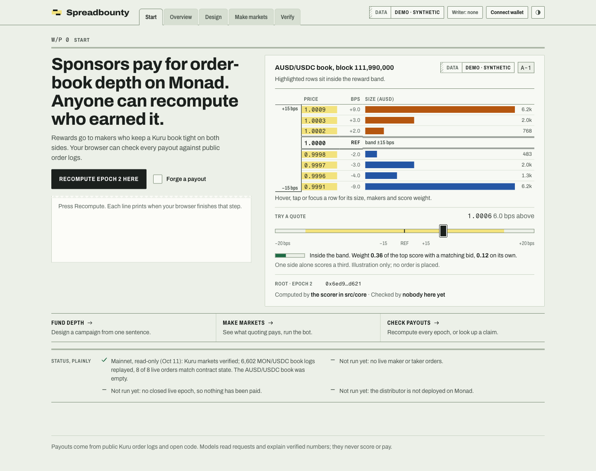
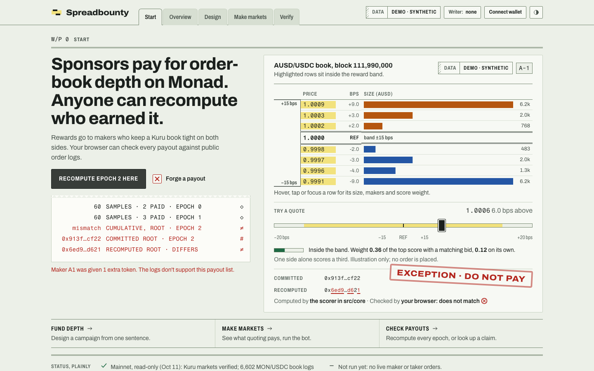
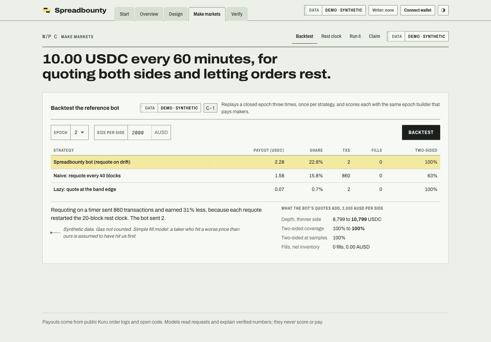
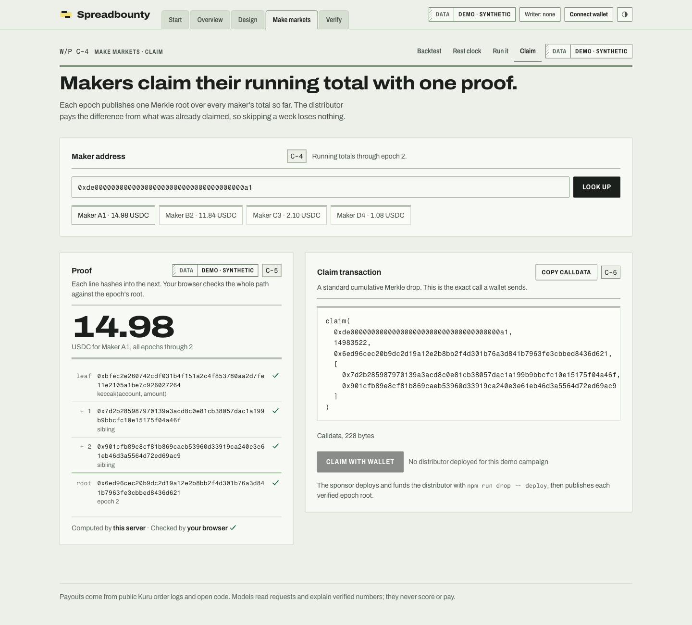

# Spreadbounty

**Pay for order-book depth on Monad, and let anyone check the payout.**


  

Built for **Metropolis (Monad)**, Track 1: Onchain Finance & Trading. By Parth Singh. MIT licensed.



[Click-through (video)](spreadbounty/docs/media/walkthrough.mp4) · [2-minute demo](spreadbounty/docs/media/spreadbounty-demo-2m.mp4) · [20-second launch video](spreadbounty/docs/media/spreadbounty-launch-20s.mp4)

## The problem

Kuru is Monad's on-chain order book, and several of its books are thin or empty. On Oct 11, 2026 the AUSD/USDC book, an official Kuru market, had **no bids and no asks** (read-only check, [report](day0/spreadbounty/reports/2026-10-11-check-AUSD-USDC.json)).

Projects that want depth pay market makers through private deals, or pay for parked capital in AMMs. Either way the payer **cannot check what it got**.

## What Spreadbounty does

1. A **sponsor funds a campaign** on one Kuru book: "$50 a day, keep AUSD/USDC two-sided within ±15 bps."
2. **Any maker can earn.** No sign-up. They rest bids and asks inside the band; orders must rest 20 blocks, so flickering quotes earn nothing.
3. The scorer **samples the book about once a minute**, at blocks picked by a later block's hash, and scores two-sided depth with Polymarket's formula.
4. Each epoch ends in a **public file and a Merkle root** that makers claim against through 1inch's unmodified `CumulativeMerkleDrop`.
5. **Anyone can recompute every payout from the public logs.** In the browser, in one click. A forged payout with a perfectly valid-looking root fails.

How it works, with a diagram and the trust model: [docs/ARCHITECTURE.md](spreadbounty/docs/ARCHITECTURE.md).

## See it

| Check a payout in your browser | Catch a forged one |
|---|---|
|  |  |

| What makers earn | Verify every epoch | Claim |
|---|---|---|
|  |  |  |

Also in dark mode and on phones: [`docs/screenshots/redesign`](spreadbounty/docs/screenshots/redesign).

## Try it in two minutes

```bash
git clone https://github.com/Ps23102004/spreadbounty && cd spreadbounty/spreadbounty
npm install
npm start          # demo data, labelled "synthetic" on every page -> http://localhost:8787
```

Press **Recompute epoch 2 here**, then tick **Forge a payout** and press it again. For real Monad data with nothing paid, see the shadow campaign: `DATA_SOURCE=live DATA_DIR=data/shadow npm run serve` ([how](spreadbounty/docs/SHADOW-RUN.md)). The AI model is optional: `AI_PROVIDER=off npm start` runs every page without one.

## Status, plainly (Oct 12, 2026)

| | |
|---|---|
| Tests | `npm run test:all` → **94 pass** (core, code boundary, AI and bring-your-own-model, maker bot, claim contract on a local EVM, server, browser recompute, judge, shadow run) |
| Mainnet, read-only | Kuru markets verified. MON/USDC: **6,602 book logs replayed, 8 of 8 live orders match** the contract's own state, with identical roots across two replays. The AUSD/USDC book was empty |
| Shadow campaign | 3 epochs scored on real MON/USDC logs, **nothing paid**. Amounts mean "would have earned" |
| Mainnet, write path | **Not run.** No live maker or taker orders, no closed live epoch, distributor not deployed on Monad |
| Users, sponsors | None yet. The ask is a one-week pilot |
| Data in the app | Labelled synthetic dataset unless `DATA_SOURCE=live` |

Independent review: two Opus 5.5 judge agents scored the build against a written rubric (security, honesty, accessibility, tests) and re-checked after fixes. Their findings drove real changes, such as the verifier now comparing every committed field. Plans and rubric: [`plans/`](plans).

## What's in this repo

| Where | What |
|---|---|
| [`spreadbounty/`](spreadbounty) | The app: scorer, claim tooling, maker bot, server and React web app. Start with its [README](spreadbounty/README.md) |
| [`day0/spreadbounty/`](day0/spreadbounty) | Read-only mainnet checks, and the optional funded live run ([runbook](day0/spreadbounty/LIVE-RUNBOOK.md)) |
| [`plans/`](plans) | Design brief, feature plan, security plan, judge rubric |
| [`video/`](video) | Sources of the launch and demo videos (HyperFrames) and the recorder |

## Documents

| Read this | For |
|---|---|
| [PRODUCT.md](spreadbounty/PRODUCT.md) | What it is, why, and why now |
| [WRITEUP.md](spreadbounty/WRITEUP.md) | The submission write-up and the evidence |
| [FAQ.md](spreadbounty/FAQ.md) | Questions a judge will ask |
| [docs/ARCHITECTURE.md](spreadbounty/docs/ARCHITECTURE.md) | How scoring, sampling and verification work |
| [docs/SHADOW-RUN.md](spreadbounty/docs/SHADOW-RUN.md) | The real-data run with nothing paid |
| [docs/AI-RUNS.md](spreadbounty/docs/AI-RUNS.md) · [docs/JUDGE.md](spreadbounty/docs/JUDGE.md) | Which models actually ran; the decision-model judge |
| [docs/PITCH_VIDEO_SCRIPT.md](spreadbounty/docs/PITCH_VIDEO_SCRIPT.md) · [docs/DEMO_SCRIPT.md](spreadbounty/docs/DEMO_SCRIPT.md) | Scripts for the pitch and the demo video |
| [docs/PROFILE.md](spreadbounty/docs/PROFILE.md) · [docs/LAUNCH.md](spreadbounty/docs/LAUNCH.md) | Project profile copy; launch kit |

Everything was built inside the hackathon window; the commit history starts Oct 9, 2026.

## Build notes

Built Oct 9–13, 2026 for the Metropolis hackathon with AI coding assistance (agent workflows supervised by Parth Singh); all code reviewed and tested before push. License: MIT — see [LICENSE](LICENSE).
