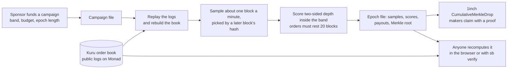

# How Spreadbounty works

One idea: **a payout is only worth paying if anyone can recompute it from public data.** Everything below follows from that.

## The five steps

1. **A sponsor funds a campaign** on one Kuru book: a price band (for example ±15 bps around the mid), a budget per epoch, and an epoch length.
2. **Any maker can earn.** No sign-up. They rest bid and ask orders inside the band. An order must have rested at least 20 blocks (about six seconds) to count, so flickering quotes earn nothing.
3. **The scorer samples the book about once a minute.** Each sample block is picked by the hash of the block that closes its window (`pickSampleBlocks` in `src/core/score.ts`), so nobody can know in advance which block counts.
4. **Scores follow Polymarket's two-sided formula.** Each resting order inside the band earns `((band - distance) / band)² × size`. Per maker, the score is `max(min(bid, ask), max(bid, ask) / 3)`: quoting both sides earns the full amount, quoting one side earns a third. All maths is integer fixed-point, so every machine gets the same root.
5. **Each epoch produces a public file** with the samples, the mid price and a book hash per sample, the scores, the payouts, and a Merkle root in the format of 1inch's `CumulativeMerkleDrop`. Makers claim their running total with a proof; skipping a week loses nothing.

## What "recompute it" means

`verifyEpoch` (in `src/core/epoch.ts`) rebuilds the epoch from the logs and block hashes, and compares **every** committed field: log digest and count, samples, scores, per-epoch payouts, cumulative totals, block range, previous root, and the root itself. One wrong digit anywhere fails.

The browser runs the same function on the Start and Verify pages. On real data it fetches the logs itself from the Monad RPC in 100-block chunks (open the Network tab and look for `eth_getLogs`).

## What you still have to trust (said plainly)

| You trust | Because |
|---|---|
| Kuru's public logs and Monad block hashes | They come from the chain, via the RPC. A bad RPC is the main residual risk. |
| The campaign terms (budget, band, rest, sample rate) | They come from the sponsor's published file on this server. The browser checks that every epoch file carries those terms and that the payouts follow from them. It cannot prove the sponsor promised something else elsewhere. |
| The Merkle distributor | It is 1inch's unmodified `CumulativeMerkleDrop`, vendored and checked against the upstream source hash. |
| The sponsor to fund it | The contract pays only what the sponsor deposited. |

For a check that depends on the chain alone, run `npm run sb -- verify <epoch file>`: it reads logs and block hashes from the chain only and takes the terms from that file.

## Where AI fits, and where it does not

A model can read a sponsor's sentence into a few fields and explain numbers the code computed. It **never** decides a payout. This is enforced, not promised: `test/boundary.test.ts` fails the build if payout code (`src/core`, `src/drop`, `src/bot`) imports the AI layer or the web app, and a grounding guard rejects any model sentence containing a number the code did not compute. Without a model, rules and templates run the same pipeline.

## Map of the code

| Path | What it does |
|---|---|
| `spreadbounty/src/core` | Book replay, sampling, scoring, epochs, Merkle tree, `verifyEpoch`. Deterministic, no network except the RPC reader. |
| `spreadbounty/src/drop` | Deploys and funds the claim contract, publishes roots, builds claims. |
| `spreadbounty/contracts` | The vendored 1inch `CumulativeMerkleDrop` and its build. |
| `spreadbounty/src/bot` | An open-source maker bot: quotes both sides, leaves good orders alone. Paper mode by default. |
| `spreadbounty/src/ai` | The optional copilot, epoch report, grounding guard and decision-model judge. |
| `spreadbounty/src/server` | The HTTP server: security headers, rate limits, wallet sign-in (EIP-4361), campaign publishing. |
| `spreadbounty/web` | The React app: Start, Overview, Design, Make markets, Claim, Verify. |
| `spreadbounty/src/cli` | The `sb` command: `market`, `epoch`, `verify`, `shadow`. |
| `spreadbounty/test` | Nine test scripts (`npm run test:all`), 94 checks. |
| `day0/spreadbounty` | Read-only checks against Kuru on mainnet, plus the funded live run (not yet run). |
| `plans`, `video` | Design brief, security plan, judge rubric; the HyperFrames sources of the launch and demo videos. |

## Shadow campaign: real data, nothing paid

`npm run sb -- shadow MON/USDC` builds a campaign back-dated onto the real MON/USDC book and scores it with the production builder. Nobody was paid and nobody knew it existed. Amounts show what makers **would have** earned under a hypothetical budget. See [SHADOW-RUN.md](SHADOW-RUN.md).
